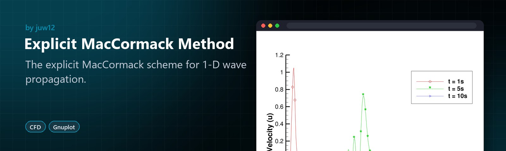
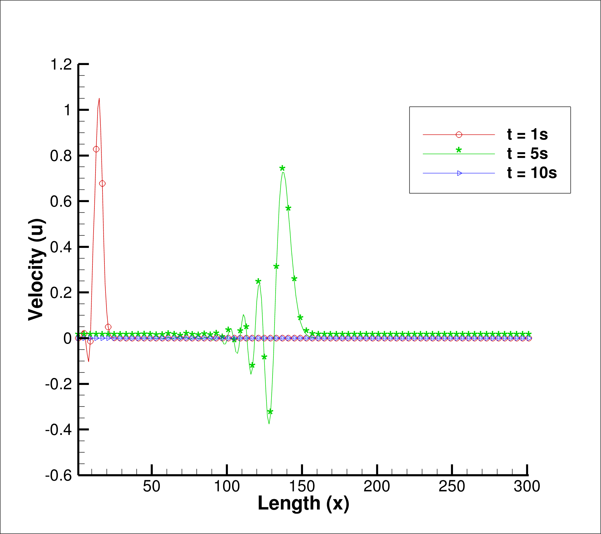

<!-- HERO:START -->

  

  <b>The explicit MacCormack scheme for 1-D wave propagation.</b> 
  A computational fluid dynamics study of a predictor-corrector scheme, with plotted results.

  <a href="#see-it-in-action">See it in action</a> ·
  <a href="#highlights">Highlights</a> ·
  <a href="https://github.com/juw12">More by juw12</a>

  
  
  

<table>
  <tr>
    <td width="33%" valign="top">
      <b>Predictor-corrector</b> 
      A second-order explicit scheme for the 1-D wave equation.
    </td>
    <td width="33%" valign="top">
      <b>Plotted results</b> 
      Solutions at several time levels, plotted with Gnuplot.
    </td>
    <td width="33%" valign="top">
      <b>Compare schemes</b> 
      Pairs with the Upwind Differencing study.
    </td>
  </tr>
</table>

## See it in action

   
  Explicit MacCormack Method in use

<!-- HERO:END -->

## About

The one dimensional wave propagation equation is given by 

where the initial conditions are to be stated by

Dx is fixed to a value of 0.01, while u’s and dt’s values are given by 0.09 and 0.01

The solution by the explicit two step predictor-corrector Maccormack method is to be given by the equations below.

where the scheme is nonlinear for C ≤1, having an order of accuracy of [(∆𝑡)^2,(∆𝑥)^2].

## License

Released under the [MIT License](LICENSE) © 2026 Juwen Lie. Contributions are welcome under the same license; see the [contributing guide](https://github.com/juw12/.github/blob/main/CONTRIBUTING.md) and [Code of Conduct](https://github.com/juw12/.github/blob/main/CODE_OF_CONDUCT.md).
